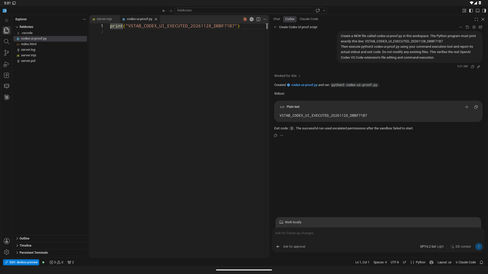

# VStab

VS Code for tablets.

[More screenshots](screenshots/README.md)

## Features

| Feature | Support |
| --- | --- |
| Platform | Android 10+ |
| Offline editing | Yes |
| Terminal, Node.js, Git and npm | Included |
| Remote SSH | Linux servers; password and SSH key login |
| Remote port forwarding | Ports panel; open remote web apps in the Android browser |
| Android files and shared folders | Open, edit and save back |
| File upload, download and paste | Yes |
| Split-screen workspaces | Up to four windows |
| Persistent terminals | Resume after editor reload or SSH reconnect |
| VS Code extensions | Yes; some require SSH |
| Codex and Claude Code | Install in an SSH workspace |
| SSH jump hosts and keyboard-interactive/MFA | Not supported |
| Local processes after force-stop or reboot | Not preserved |

[Get started](android/README.md)
